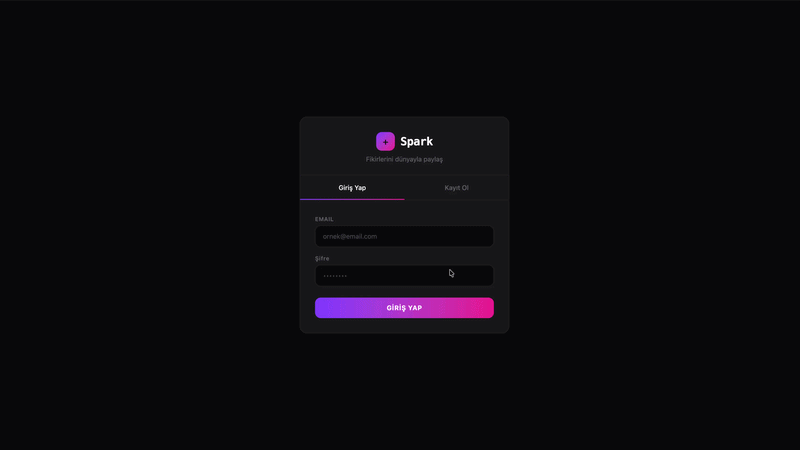

# ✦ Spark

Modern, gerçek zamanlı sosyal medya uygulaması. React, Tailwind CSS v4 ve Firebase ile geliştirildi.


---

## 📸 Ekran Görüntüleri



---

## ✨ Özellikler

- 🔐 **Authentication** — Email/şifre ile kayıt ve giriş
- 📸 **Gönderi Paylaşma** — Yazı ve resim URL ile gönderi oluştur
- ❤️ **Beğeni Sistemi** — Gönderileri beğen/beğeniyi geri al
- 💬 **Yorumlar** — Gönderilere yorum yap, sil
- 👥 **Takip Sistemi** — Kullanıcıları takip et/takipten çık
- 👤 **Profil Sayfası** — Bio düzenleme, gönderi/takipçi/takip sayıları
- 🔔 **Bildirim Sistemi** — Beğeni, yorum ve takip bildirimleri
- 🔍 **Explore & Arama** — Kullanıcı arama, popüler ve en yeni gönderiler
- 📱 **Responsive** — Mobil ve masaüstü uyumlu

---

## 🛠️ Teknolojiler

| Teknoloji | Kullanım |
|-----------|----------|
| React 19 | UI framework |
| Vite | Build tool |
| Tailwind CSS v4 | Styling |
| Firebase Auth | Kullanıcı girişi |
| Cloud Firestore | Gönderiler, yorumlar, kullanıcılar |
| Firebase Realtime DB | Bildirimler |
| React Router v6 | Sayfa yönlendirme |
| Framer Motion | Animasyonlar |
| React Hot Toast | Bildirimler |
| Zustand | Global state yönetimi |

---

## 📁 Proje Yapısı

```
src/
├── components/
│   ├── Navbar.jsx              # Navigasyon & bildirim butonu
│   ├── CreatePost.jsx          # Gönderi oluşturma
│   ├── PostList.jsx            # Gönderi listesi
│   ├── PostCard.jsx            # Tekil gönderi kartı
│   └── NotificationPanel.jsx  # Bildirim paneli
├── context/
│   └── AuthContext.jsx         # Global auth state
├── firebase/
│   ├── config.js               # Firebase konfigürasyonu
│   └── notifications.js        # Bildirim gönderme fonksiyonu
├── hooks/
│   ├── useMessages.js          # Mesaj hook'u
│   ├── usePresence.js          # Online takip hook'u
│   └── useNotifications.js     # Bildirim hook'u
├── pages/
│   ├── AuthPage.jsx            # Giriş / kayıt
│   ├── FeedPage.jsx            # Ana akış
│   ├── PostPage.jsx            # Gönderi detay & yorumlar
│   ├── ProfilePage.jsx         # Kullanıcı profili
│   └── ExplorePage.jsx         # Keşfet & arama
├── routes/
│   ├── ProtectedRoute.jsx      # Giriş gerektiren sayfalar
│   └── GuestRoute.jsx          # Sadece misafirler için
├── store/
│   ├── usePostStore.js         # Gönderi state yönetimi
│   └── useUserStore.js         # Kullanıcı state yönetimi
├── App.jsx
└── main.jsx
```

---

## 🚀 Kurulum

### 1. Repoyu klonla

```bash
git clone https://github.com/ualperen41/spark.git
cd spark
```

### 2. Paketleri yükle

```bash
npm install
```

### 3. Firebase projesi oluştur

1. [Firebase Console](https://console.firebase.google.com)'a git
2. Yeni proje oluştur
3. **Authentication** → Email/Password aktifleştir
4. **Firestore Database** → Test modunda oluştur
5. **Realtime Database** → Test modunda oluştur
6. Web uygulaması ekle ve config bilgilerini kopyala

### 4. .env dosyası oluştur

Projenin root'unda `.env` dosyası oluştur:

```env
VITE_FIREBASE_API_KEY=YOUR_API_KEY
VITE_FIREBASE_AUTH_DOMAIN=YOUR_PROJECT.firebaseapp.com
VITE_FIREBASE_PROJECT_ID=YOUR_PROJECT_ID
VITE_FIREBASE_STORAGE_BUCKET=YOUR_PROJECT.appspot.com
VITE_FIREBASE_MESSAGING_SENDER_ID=YOUR_SENDER_ID
VITE_FIREBASE_APP_ID=YOUR_APP_ID
VITE_FIREBASE_DATABASE_URL=https://YOUR_PROJECT-default-rtdb.firebaseio.com
```

### 5. Firestore Rules

Firebase Console → Firestore Database → Rules:

```
rules_version = '2';
service cloud.firestore {
  match /databases/{database}/documents {
    match /{document=**} {
      allow read, write: if true;
    }
  }
}
```

### 6. Realtime Database Rules

```json
{
  "rules": {
    ".read": "auth != null",
    ".write": "auth != null"
  }
}
```


